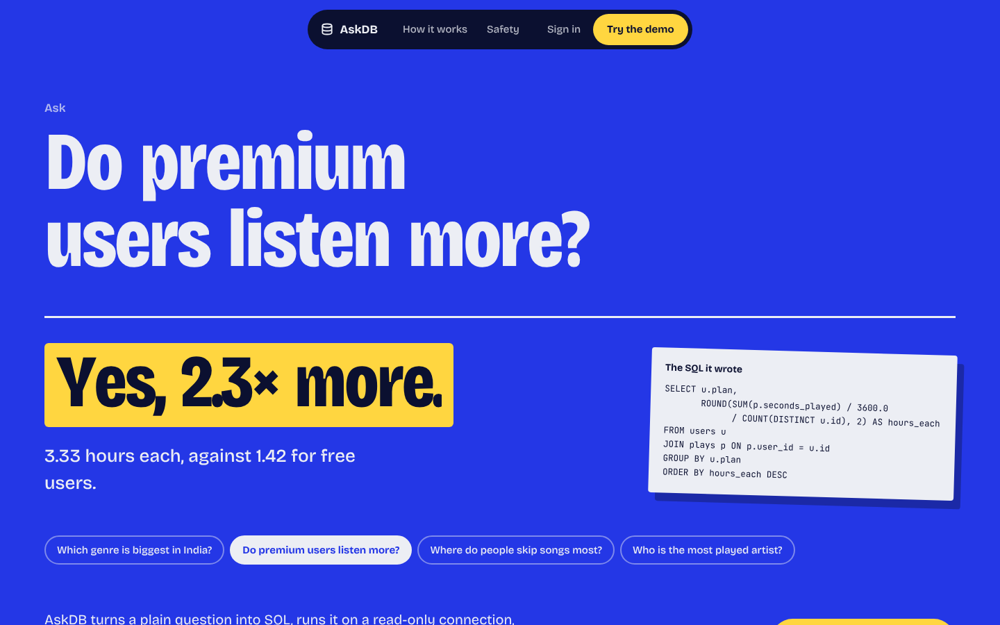
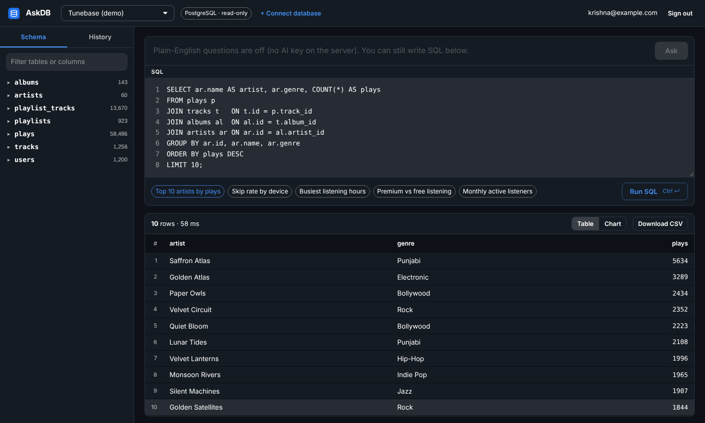
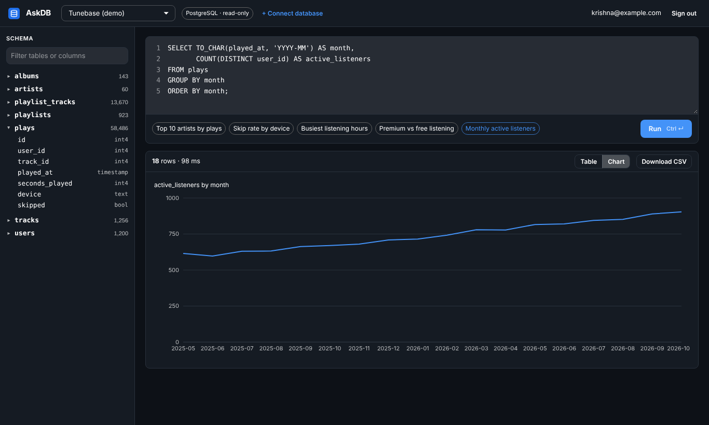

# AskDB

Ask a database questions in plain English and get back the SQL, the answer, and a chart.





> **Status: Phases 0–2 built.** Sign up, connect a PostgreSQL or MySQL database (or use the built-in demo),
> ask a question in plain English, and get the SQL, a one-line answer, and a table or chart.
> Not deployed yet (Phase 3).

## Why this exists

Most people who need data can't write SQL, and the people who can get interrupted all day.
AskDB sits in between: you ask *"which device do people skip songs on the most?"*, it writes the query,
runs it on a **read-only** connection, and shows the result. The SQL is always visible, so you can check
what it actually did.

## Tech stack

| Layer      | Tech                                                        |
| ---------- | ----------------------------------------------------------- |
| Backend    | Java 21, Spring Boot 3, Maven                               |
| App data   | PostgreSQL, Spring Data JPA                                 |
| Security   | Spring Security + JWT, BCrypt for logins, AES-256-GCM for saved database passwords |
| SQL safety | JSqlParser + read-only transactions + timeout + row cap     |
| AI         | Groq (any OpenAI-compatible API), called with Spring's RestClient |
| Frontend   | React, Vite, MUI, Recharts, GSAP (landing page animation)   |
| DevOps     | Docker Compose, GitHub Actions (Render + Vercel in Phase 3) |

## How it works

```
Browser (React)  ──JWT──▶  Spring Boot API  ──JPA──▶  PostgreSQL "askdb"   (users, saved connections)
                                 ├──HTTPS──▶  AI model (Groq): question + schema in, SQL out
                                 │
                                 └──JDBC, read-only──▶  the database being queried
                                                        (built-in "tunebase" demo, or the user's own PostgreSQL / MySQL)
```

There are two kinds of database here, and keeping them apart is the main design idea:

- **App database**: AskDB's own tables (`users`, `db_connections`), managed with JPA.
- **Target database**: whatever the user wants to ask questions about. AskDB only ever reads from it, over plain JDBC.

## How a question becomes an answer

`AskService.java` does this for every question:

1. **Describe the database** to the model: tables, columns, foreign keys and three sample rows per table
   (so it can see that `plan` holds `'free'` / `'premium'` / `'family'`). Cached for ten minutes.
2. **Ask for one SELECT** in the right dialect (PostgreSQL or MySQL). The model may also answer
   `CANNOT_ANSWER` if the question doesn't fit the data.
3. **Run it through the normal safe path** (below). The model's SQL gets no special trust.
4. **Self-repair**: if the query fails, the model is shown its own SQL and the database's error message and
   asked to fix it, up to three attempts in total. A dead connection is not retried; only bad SQL is.
5. **Summarise**: the first 20 rows go back to the model for a one or two sentence answer. If that fails,
   the user still gets the table.

Each user is limited to 15 questions a minute (`RateLimiter.java`), and the SQL is always shown and editable.

**Privacy note:** the schema, three sample rows per table and the first rows of each result are sent to the
AI provider. Summaries can be switched off with `ASKDB_AI_SUMMARIES=false`.

## How queries are kept safe

Every query passes four independent checks (`QueryExecutor.java`):

1. **Parsed, not pattern-matched** (`SqlGuard.java`): JSqlParser turns the SQL into a syntax tree. It must be exactly
   one statement and that statement must be a `SELECT`. Because it's a real parser, `'drop table'` inside a string
   is fine, and `SELECT 1; DROP TABLE users` is correctly seen as two statements.
2. **Read-only transaction**: the connection is switched to read-only, so the database itself refuses any write
   that somehow got past step 1.
3. **Timeout**: queries are cancelled after 5 seconds.
4. **Row cap**: at most 500 rows come back.

SQL written by the AI model is untrusted input and goes through this same path.

## How secrets are handled

| What                     | How it's stored                    | Why                                                         |
| ------------------------ | ---------------------------------- | ----------------------------------------------------------- |
| Login password           | BCrypt hash                        | We never need the original back, so it's one-way            |
| Saved database password  | AES-256-GCM, random IV per value   | We *do* need it back to connect; the key lives in an env variable, not in the database |
| Login session            | JWT (HMAC-SHA256), 12 h expiry     | Stateless: the server keeps no session table                |

Other details: saved passwords are never sent back to the browser; connections are always looked up by
*id + owner*, so one user can't reach another's; host and database names are validated so they can't inject
JDBC driver options; private network addresses can be blocked (`ASKDB_BLOCK_PRIVATE_HOSTS=true`) for public deployments.

## The demo database

`db/init/01-tunebase-demo.sql` builds **Tunebase**, a fictional music-streaming service, in pure SQL
(`generate_series` + a fixed random seed, so it's the same on every machine; nothing in it is real).
Every user gets it as a ready-made connection, through a login that can only read.

| Table             | Rows   | What it holds                                              |
| ----------------- | ------ | ---------------------------------------------------------- |
| `artists`         | 60     | name, country, genre, debut year                           |
| `albums`          | ~140   | release dates, linked to artists                           |
| `tracks`          | ~1.3k  | duration, language, explicit flag                          |
| `users`           | 1,200  | city, country, birth year, plan (free / premium / family)  |
| `plays`           | ~58k   | every listen: when, which device, how long, skipped or not |
| `playlists`       | ~900   | user playlists, public or private                          |
| `playlist_tracks` | ~13.5k | which tracks are in which playlist                         |



## Run it locally

The only thing to install is [Docker Desktop](https://www.docker.com/products/docker-desktop/).

```bash
docker compose up --build
```

Then open http://localhost:5173, create an account, and run one of the example queries.

To switch on plain-English questions, get a free API key from [console.groq.com](https://console.groq.com),
create a file called `.env` next to `docker-compose.yml` containing `ASKDB_AI_API_KEY=gsk_...`, and start it again.
Without a key the app still works in SQL mode.
The first start takes a few minutes (it downloads Java libraries and builds the demo data).

<details>
<summary>Running without Docker (for development)</summary>

Needs Java 21, Maven, Node 20+ and a PostgreSQL 16 server with the seed script loaded
(`psql -U askdb -d askdb -f db/init/01-tunebase-demo.sql`).

```bash
cd backend && mvn spring-boot:run      # API on http://localhost:8080
cd frontend && npm install && npm run dev   # UI on http://localhost:5173
```

Tests: `cd backend && mvn verify` (they use an in-memory H2 database, so no setup is needed).
</details>

## API

All endpoints except register, login and health need `Authorization: Bearer <token>`.

| Method | Path                           | Description                                         |
| ------ | ------------------------------ | --------------------------------------------------- |
| POST   | `/api/auth/register`           | Create an account, returns a token                  |
| POST   | `/api/auth/login`              | Returns a token                                     |
| GET    | `/api/auth/me`                 | The signed-in user                                  |
| GET    | `/api/connections`             | Demo database + the user's saved connections        |
| POST   | `/api/connections`             | Test, then save a connection (password encrypted)   |
| POST   | `/api/connections/test`        | Test connection details without saving              |
| DELETE | `/api/connections/{id}`        | Remove a saved connection                           |
| GET    | `/api/connections/{id}/schema` | Tables, columns, keys, row counts                   |
| POST   | `/api/connections/{id}/query`  | `{ "sql": "..." }` → columns, rows, timing          |
| POST   | `/api/connections/{id}/ask`    | `{ "question": "..." }` → SQL, attempts, summary, result |
| GET    | `/api/connections/{id}/history`| Last 30 questions and queries on this connection    |
| DELETE | `/api/connections/{id}/history`| Clear that history                                  |
| GET    | `/api/health`                  | Public health check; also says whether AI is switched on |

## Project layout

```
backend/src/main/java/com/askdb/
  security/     SecurityConfig, JwtService, JwtAuthFilter, CryptoService (AES)
  user/         User entity, register / login
  connection/   saved connections (entity, repository, service, controller)
  query/        SqlGuard (JSqlParser), QueryExecutor, SchemaReader, JdbcConnector
  ai/           AskService (question → SQL → answer), LlmClient, RateLimiter
  history/      saved questions and queries
  common/       error handling, health check
  config/       typed application settings
backend/src/test/   unit tests (guard, JWT, AES, AI flow with a fake model, rate limiter) + full API flow tests
frontend/src/
  landing/      public landing page (GSAP animation, self-hosted Bricolage Grotesque + JetBrains Mono fonts)
  auth/         sign in / create account
  workspace/    ask bar, schema sidebar, history, SQL editor, results table, chart, connect-database dialog
  api.js        every backend call, token handling
db/init/        demo database seed script
```

## Roadmap

- [x] **Phase 0 – Foundation**: accounts, encrypted saved connections, schema browser, safe query execution, table + chart results, demo data, tests, CI
- [x] **Phase 1 – Plain English → SQL**: schema-aware prompt (Groq), generated SQL always shown and editable, self-repair when the SQL fails, per-user rate limit
- [x] **Phase 2 – Answers, not just tables**: one-line summary of the result, table or chart view, query history
- [ ] **Phase 3 – Ship it**: backend on Render, frontend on Vercel
